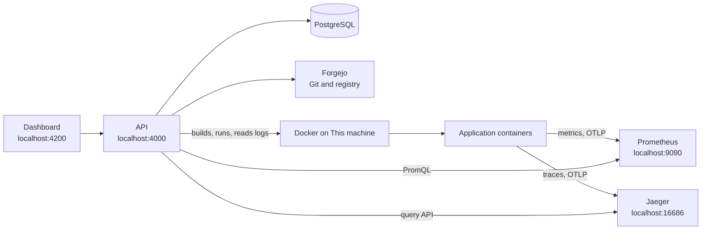

# Current flows and how to test them, November 2026

A guide to every flow DreamDevOps offers today, from signing in to watching a running application, with what to do, what to expect and where to look, so changes can be tested end to end. It pays most attention to what changed recently: monitoring with metrics, logs, traces and container limits, the blueprints that feed it, and two fixes for local setups.

## Contents

- [What changed recently](#what-changed-recently)
- [The system at a glance](#the-system-at-a-glance)
- [Before you start](#before-you-start)
- [Accounts and what each can do](#accounts-and-what-each-can-do)
- [Flow 1: Start a company and its team](#flow-1-start-a-company-and-its-team)
- [Flow 2: Register an application](#flow-2-register-an-application)
- [Flow 3: Build an image](#flow-3-build-an-image)
- [Flow 4: Create an environment and deploy](#flow-4-create-an-environment-and-deploy)
- [Flow 5: Variables, secrets and telemetry settings](#flow-5-variables-secrets-and-telemetry-settings)
- [Flow 6: Metrics and container limits](#flow-6-metrics-and-container-limits)
- [Flow 7: Logs](#flow-7-logs)
- [Flow 8: Traces within one application](#flow-8-traces-within-one-application)
- [Flow 9: A trace from a frontend to a backend](#flow-9-a-trace-from-a-frontend-to-a-backend)
- [Flow 10: A trace between two backends](#flow-10-a-trace-between-two-backends)
- [Flow 11: Stopping, moving and rolling back](#flow-11-stopping-moving-and-rolling-back)
- [Flow 12: Company separation](#flow-12-company-separation)
- [Flow 13: When something is down](#flow-13-when-something-is-down)
- [Test checklist](#test-checklist)
- [Automated tests](#automated-tests)
- [Troubleshooting](#troubleshooting)
- [Known limitations](#known-limitations)
- [Reference](#reference)

## What changed recently

| Change | What it gives | Where it's described |
|---|---|---|
| **Monitoring** page and context | Each running application's CPU, memory, requests, response times and server errors, now and charted over 15 minutes to 24 hours | [Monitoring guide](../../apps/api/src/monitoring/README.md) |
| Container limits | CPU and memory shown against what each container may use, such as **13% of 1 CPU** and **50.0 MiB of 512 MiB, 10%**, standing out from 90% | [Limits](../../apps/api/src/monitoring/README.md#limits) |
| Logs | What each running container writes, with level, message and trace, newest first, with a filter | [Logs](../../apps/api/src/monitoring/README.md#logs) |
| Traces | Each request through one or more applications, as a timeline, showing only the company's own spans | [Traces](../../apps/api/src/monitoring/README.md#traces) |
| Prometheus and Jaeger | The local stack keeps metrics and traces, at <http://localhost:9090> and <http://localhost:16686> | [Local services](../../infra/local/README.md#metrics-and-traces) |
| Blueprints 1.2.0 | Metrics from both blueprints | [Blueprints](../../blueprints/README.md#metrics-logs-and-traces) |
| Blueprints 1.3.0 | JSON logs with trace IDs, `GET /api/ping`, traces passed between applications, opt-in CORS, and **Check the API** on the frontend | The same |
| Deployments record limits | The **Start the new version** step shows *Limits: 1 CPU and 512 MiB of memory*, and migration `0015` fills them in for what already runs | [Environments](../../apps/api/src/environments/README.md#deploying) |
| Prometheus and Jaeger images from Quay | Docker Hub refused the first image. Both now come from the projects' own registries, and `PROMETHEUS_IMAGE` and `JAEGER_IMAGE` can change them. | [Troubleshooting](../../README.md#troubleshooting) |
| Builds on Windows | **Get the source** failed with *Cannot connect to C: resolve failed*, because Git for Windows' `tar` read `C:\…` as a remote machine. `tar` now gets relative names only. | [Builds](../../apps/api/src/builds/README.md#the-steps) |

## The system at a glance



How monitoring data moves:

| Signal | Sent by | Through | Kept by | Read by the API through |
|---|---|---|---|---|
| Metrics | The application, every 15 seconds | OTLP to `host.docker.internal:9090/api/v1/otlp/v1/metrics` | Prometheus, 15 days | PromQL, by `dreamdevops_environment_id` |
| Traces | The application, as requests finish | OTLP to `host.docker.internal:4318/v1/traces` | Jaeger, in memory | Jaeger's query API, by service name, then by environment ID |
| Logs | The application, by writing to its output | Nothing: Docker keeps the container's output | Docker, until the container is replaced | `docker logs` on the host it runs on |
| Limits | The host, as it starts the container | The deployment's record | PostgreSQL | The published `RunningEnvironments` |

When a container starts, the platform gives it the standard OpenTelemetry settings:

- where to send metrics and traces
- the service name, which is the application's short name
- `dreamdevops.environment.id`, the environment's ID

So any OpenTelemetry application reports, and everything it sends says which environment it came from.

## Before you start

Run these from the repository root. Steps 3 and 4 matter for the latest change.

1. **Copy new settings.** Compare `infra/local/.env` with `infra/local/.env.example`. Nothing new is required, but `PROMETHEUS_PORT`, `JAEGER_PORT`, `JAEGER_OTLP_PORT` and the `*_IMAGE` settings are listed there.
2. **Start the local services:**
   ```bash
   docker compose -f infra/local/compose.yaml run --rm start
   ```
3. **Check them.** All 14 checks should say `PASS`, including *Prometheus accepts metrics over OTLP* and *Jaeger keeps traces sent over OTLP*:
   ```bash
   docker compose -f infra/local/compose.yaml run --rm smoke-test
   ```
4. **Apply the migrations.** This adds `0015_record-container-limits`, which the API needs:
   ```bash
   npm run db:migrate
   ```
5. **Start the API**, which sets `PROMETHEUS_URL`, `JAEGER_URL` and where containers send metrics and traces:
   ```bash
   npm run start:api
   ```
6. **Start the dashboard** in a second terminal, and open <http://localhost:4200>:
   ```bash
   npm run start:dashboard
   ```
7. **Deploy again** anything that ran before these changes. Containers get their telemetry settings as they start, so older ones send no traces, and only redeployed ones can pass traces on.

## Accounts and what each can do

Every sample account's password is `KEYCLOAK_DEV_USER_PASSWORD` in `infra/local/.env`. All but the Platform Admin belong to **Dummy Company**.

| Account | Role | Use it to test |
|---|---|---|
| `dev-platform-admin` | Platform Admin | Starting companies and choosing editions. Sees no company data, and no **Monitoring**. |
| `dev-company-admin` | Company Admin | The team, the audit log, notifications, applications, non-production environments. Doesn't deploy. |
| `dev-tech-lead` | Tech Lead | Releases, every environment, deploying anywhere, production |
| `dev-developer` | Developer | Development images, deploying outside production |
| `dev-operator` | Operator | Hosting targets, environments, deploying anywhere, production |
| `dev-viewer` | Viewer | Reading only: **Monitoring**, with metrics, logs and traces, works for this role too |

**Monitoring**, with its metrics, logs and traces, needs `dashboards:view`, which every company role has. Nothing on it changes anything.

## Flow 1: Start a company and its team

Only needed to test company separation, in [Flow 12](#flow-12-company-separation). Dummy Company is ready otherwise.

1. As `dev-platform-admin`, open **Companies**, and enter a name and the email of an account you'll register.
2. Wait until the company shows **Active**. That means its Git organization exists in Forgejo.
3. Sign out, open the invitation in Mailpit at <http://localhost:8025>, register with that email, and accept.
4. As the new Company Admin, invite others under **Team**.

**Expect:** the audit log of the company lists each step.

## Flow 2: Register an application

1. As `dev-tech-lead`, open **Applications**, and register one of each type:
   - *Billing API*, a **RESTful Service**
   - *Web*, a **Web Frontend**
2. Wait until each repository shows as ready.

**Expect:** **Blueprints** shows `node-service 1.3.0` and `angular-frontend 1.3.0` as the newest, and new repositories start from them. In Forgejo, the backend repository has:
- `src/logging.ts`
- `GET /api/ping` in `src/app.ts`
- `@opentelemetry/instrumentation-undici` in `package.json`

The frontend repository has:
- `src/app/trace-context.ts`
- `log_format json` in `nginx/default.conf`
- `nginx/send-metrics.sh`

Applications registered earlier keep the version they started from. The [blueprints guide](../../blueprints/README.md#metrics-logs-and-traces) lists which files bring them up to date.

## Flow 3: Build an image

1. As `dev-tech-lead`, open **Builds**, choose the application, and **Start release 0.1.0**, or whichever version it offers. That creates a release branch and builds its first candidate.
2. Choose **Show progress** to follow the steps: **Get the source**, **Validate**, **Build**, **Check the image**, **Scan**, **Publish**, **Sign**, **Verify**.

**Expect:** every step passes. On Windows, **Get the source** works whichever `tar` comes first on the PATH.

**Faster:** set `IMAGE_SCANNER=none` in `.env` to skip scanning while testing. The step then shows as skipped.

For a development image instead: in Forgejo, open a pull request from a `feature/*` branch into `develop`. Then, as `dev-developer`, choose **Build image** beside it.

## Flow 4: Create an environment and deploy

1. As `dev-tech-lead`, open **Environments**, choose the application, and create *Staging*. It runs on **This machine** unless you choose another target.
2. Choose **Deploy**, pick the version that built, and follow the steps:
   1. **Check the version and environment**
   2. **Verify the signature**
   3. **Pull the image**
   4. **Start the new version**
   5. **Wait until it's healthy**

**Expect:**

- **Start the new version** lists *Container*, *Port*, *Limits: 1 CPU and 512 MiB of memory*, *Variables* and *Secrets*.
- The environment shows the version and its address, such as `http://localhost:49153`. The port stays the same across deployments.
- For the backend, `http://localhost:<port>/api/ping` answers `{"status":"ok","time":"…"}`. For the frontend, its address shows the app.

**Check on the machine:**

```bash
docker ps --filter label=dreamdevops.managed=true --format '{{.Names}}  {{.Ports}}'
docker inspect <container> --format 'memory={{.HostConfig.Memory}} cpus={{.HostConfig.NanoCpus}}'
```

The second command shows `memory=536870912 cpus=1000000000`: 512 MiB and one CPU, the same as the **Limits** fact.

## Flow 5: Variables, secrets and telemetry settings

1. On **Environments**, open **Variables** on *Staging*, and add `LOG_LEVEL=debug`, or any other value.
2. The environment says what runs has older settings. Choose **Apply now**, which deploys the same version again with them.

**Expect, for telemetry:**

- **Settings the platform adds.** Every container gets `OTEL_SERVICE_NAME`, `OTEL_EXPORTER_OTLP_METRICS_ENDPOINT`, `OTEL_EXPORTER_OTLP_TRACES_ENDPOINT`, `OTEL_METRIC_EXPORT_INTERVAL` and `OTEL_RESOURCE_ATTRIBUTES`.
- **Your own values win, except the environment ID.** An environment's own value for any of them replaces the platform's. `OTEL_RESOURCE_ATTRIBUTES` is the exception: the platform adds `dreamdevops.environment.id=<id>` after your attributes, so it's the one that counts.

To see them, without secrets, run:

```bash
docker inspect <container> --format '{{range .Config.Env}}{{println .}}{{end}}' | grep OTEL
```

Don't share that command's full output: it includes the environment's secrets.

## Flow 6: Metrics and container limits

1. Open **Monitoring**, as any company role.
2. Generate traffic on the backend for a minute, such as with `curl -s http://localhost:<port>/api/ping` every second.

**Expect, in the table:**

- **Each environment** that runs a version appears once, by application, with production last. Values appear 15 to 30 seconds after a container starts, because rates need a few samples.
- **CPU** reads like `2.5% of 1 CPU`, and **Memory** like `50.0 MiB of 512 MiB, 10%`. Either stands out in red from 90% of its limit.
- **Backends** show **Requests**, **Response time** and **Server errors**. Frontends show **No data** there, because nginx only serves files.
- **Health checks** don't count as requests.
- **A row with no metrics yet** says *No metrics received yet.*
- **Refresh:** the page reads everything again every 30 seconds.

**Expect, in the details.** Choose **Show details**:

- **Heading:** *Its container may use at most 1 CPU and 512 MiB of memory, on This machine.*
- **Charts:** five of them, for the range chosen. CPU and memory add *of a limit of 1 CPU* and *of a limit of 512 MiB*.
- **Gaps:** where the application sent nothing, the line breaks.

**Seeing a value near its limit.** Memory only nears 512 MiB with real load. To see the red highlight, build a feature image of the backend with a temporary route. Deploy it to a test environment, open the route, and remove the route afterwards:

```ts
// Temporary, to test the highlight: holds about 470 MiB until the container restarts.
const held: Buffer[] = [];
app.get('/api/hold-memory', async () => {
  held.push(Buffer.alloc(470 * 1024 * 1024, 1));
  return { held: held.length };
});
```

**Check against the source:** in Prometheus, at <http://localhost:9090>, query these. The dashboard's values come from the same series:

- `process_memory_usage_bytes`
- `rate(process_cpu_time_seconds_total[2m]) * 100`
- `http_server_request_duration_seconds_count`

## Flow 7: Logs

1. In **Monitoring**, choose **Show details** on an environment. The **Logs** section shows the latest 500 lines of the range, newest first.
2. Type in **Filter** to narrow them by text, level or trace ID.

**Expect, for a backend from 1.3.0:**

- Opening `/api/ping` adds three lines:
  - `incoming request: GET /api/ping`
  - `Ping received`
  - `request completed: 200 in 2 ms`
- **Levels:** each line shows its level, such as *info*.
- **Traces:** each line has a **Trace** button, because it was written in one.
- **Greetings:** `/api/hello?name=Ada` logs `Greeting sent`.
- **Health checks** aren't logged.

**Expect, for a frontend from 1.3.0:**

- **Opening the app's page** adds one line per file: `GET / 200`, the JavaScript and CSS files, and `GET /config.json 200`.
- **Stderr lines:** nginx's start-up notices are marked **stderr**.

**Expect, for older versions:** their lines show as they are. A backend from 1.2.0 or earlier still writes JSON, so levels show, but with no **Trace** button.

**Check against the source:**

```bash
docker logs --timestamps --tail 20 <container>
```

**Note:** lines come from the container that runs now. A new deployment, **Apply now** included, starts them afresh.

## Flow 8: Traces within one application

1. Open `http://localhost:<port>/api/ping` on a backend deployed since Prometheus and Jaeger were added.
2. In **Monitoring**, **Show details**, the **Traces** section lists the request as `GET`, with its duration and span count.
3. Choose **Show trace**, or **Trace** on its log line.

**Expect:**

- **The trace opens below** as a timeline: the `GET` span of *Billing API in Staging*, with `server GET /api/ping 200` and its duration.
- **Errors:** a request that fails with a 5xx shows in red, with *1 error* in the list.
- **Close trace** closes it.

**Check against the source:** in Jaeger, at <http://localhost:16686>, choose the application's short name as the service.

## Flow 9: A trace from a frontend to a backend

This is the flow that shows the trace logic across applications today.

1. Deploy the backend (Billing API) and the frontend (Web), each to an environment on This machine. Note their addresses:
   - the backend's, such as `http://localhost:49153`
   - the frontend's, such as `http://localhost:49154`
2. On the **backend**'s environment, add `CORS_ORIGINS=http://localhost:49154`, exactly as the browser's address bar shows the frontend, and choose **Apply now**.
3. On the **frontend**'s environment, add `API_URL=http://localhost:49153/api`, and choose **Apply now**.
4. Open the frontend, and choose **Check the API**.

**Expect:**

- **The page** says *The API answered. Trace ID:* followed by 32 hexadecimal digits.
- **The backend's logs** in **Monitoring**, filtered by that trace ID, show `Ping received`, and its **Trace** opens that trace.
- **The timeline** shows the backend's span. It starts a branch of its own, because the browser doesn't report its own span yet.
- **The frontend's logs** show the page and its files. The ping goes from the browser straight to the backend, so it isn't there.

**If it fails:**
- *The API didn't answer.* with no status means the browser refused it. Check that `CORS_ORIGINS` matches the frontend's origin exactly, with `localhost` and not `127.0.0.1`, and no trailing slash.
- *(HTTP 404)* means `API_URL` misses `/api`.

## Flow 10: A trace between two backends

This prepares for applications that call each other. Backends from 1.3.0 pass the trace on in every `fetch`, and continue the trace they receive.

1. In a second backend, *Orders API*, add a route that calls the first one, and deploy it:
   ```ts
   app.get('/api/check-billing', async (request) => {
     const response = await fetch(`${process.env.BILLING_URL}/api/ping`);
     request.log.info({ status: response.status }, 'Billing answered');
     return { billing: response.status };
   });
   ```
2. Give Orders' environment `BILLING_URL=http://host.docker.internal:49153`, the billing backend's port as the machine sees it, and open Orders' `/api/check-billing`.

**Expect:** one trace across both applications, in this order:

- Orders' `GET` server span, for `/api/check-billing`
- its `GET` client span, for the call
- Billing's `GET` server span under it, for `/api/ping`

Both applications' log lines carry the same trace ID.

Every app container can reach any other's published port through `host.docker.internal`, the way they reach Prometheus and Jaeger. That works with Docker Desktop only.

## Flow 11: Stopping, moving and rolling back

| Action | How | Expect in **Monitoring** |
|---|---|---|
| Deploy again, or **Apply now** | **Deploy** the same version, or change a variable | The row stays. Logs start afresh with the new container. The limits shown are the new deployment's. |
| A version that isn't healthy | Deploy an image whose health check fails | The deployment rolls back. Monitoring keeps showing what runs, the version before. |
| **Stop** | **Stop** on the environment | The row disappears. Its logs are gone. Its metrics stay in Prometheus until they age out. |
| Move | **Edit** the environment, and choose another target that deploys | What runs moves, with its new deployment's limits |

## Flow 12: Company separation

Checks that no company sees another's data. Use a second company from [Flow 1](#flow-1-start-a-company-and-its-team), with one running environment in each.

1. In the dashboard, each company's **Monitoring** lists only its own environments.
2. Copy a trace ID from company A's logs. Signed in as company B, open:
   `http://localhost:4000/api/v1/company/monitoring/traces/<trace ID>`

**Expect:**
- **Another company's trace** answers `404`, *There’s no such trace, or none of it comes from your applications.*
- **Another company's logs and metrics** answer `404`, *There’s no such environment.*, when opened with company A's environment ID:
  - `…/monitoring/environments/<A's environment ID>/logs`
  - `…/monitoring/environments/<A's environment ID>`

  An environment's ID is on its container's label `dreamdevops.environment-id`.
- **A trace through both companies' services** shows each company only its own spans. It says how many from elsewhere aren't shown.

Prometheus's and Jaeger's own pages show every company's data. They're for whoever runs the machine, not for company members.

## Flow 13: When something is down

| Stop this | How | Expect |
|---|---|---|
| Prometheus | `docker compose -f infra/local/compose.yaml stop prometheus` | The table still lists what runs, with *The metrics store can’t be reached right now.* Charts say the same. Logs and traces still work. |
| Jaeger | `docker compose -f infra/local/compose.yaml stop jaeger` | **Traces** says *The trace store can’t be reached right now.* Everything else works. Applications keep running. |
| Docker | Quit Docker Desktop | **Logs** says *The logs can’t be read from This machine right now.* |
| Metrics or traces turned off | Start the API without `PROMETHEUS_URL` or `JAEGER_URL` | *This server doesn't keep applications' metrics yet*, or *doesn't keep traces yet*. Logs still work. |

Start them again with `docker compose -f infra/local/compose.yaml run --rm start`. Jaeger starts empty, since it keeps traces in memory.

## Test checklist

| # | Check | Account | Passes when |
|---|---|---|---|
| 1 | Smoke test | None | 14 checks pass |
| 2 | Migrations | None | `npm run db:migrate` applies `0015_record-container-limits`, or says it's there |
| 3 | Build on this OS | `dev-tech-lead` | Every step passes, **Get the source** included |
| 4 | Deploy | `dev-tech-lead` | **Start the new version** shows *Limits: 1 CPU and 512 MiB of memory* |
| 5 | Monitoring table | `dev-viewer` | Each running environment, CPU and memory with their limits |
| 6 | Near a limit | `dev-developer` | Memory at 90% or more stands out in red |
| 7 | Charts | `dev-viewer` | Five charts, CPU and memory with their limits, ranges switch |
| 8 | Backend logs | `dev-viewer` | `/api/ping` logs `Ping received` with a **Trace** button |
| 9 | Frontend logs | `dev-viewer` | Opening the page logs `GET / 200` |
| 10 | Log filter | `dev-viewer` | Filtering by a trace ID leaves that request's lines |
| 11 | Traces | `dev-viewer` | `/api/ping` shows as a trace, and opens as a timeline |
| 12 | Frontend to backend | `dev-tech-lead` | **Check the API** answers, and its trace ID finds the backend's line and trace |
| 13 | Company separation | Two companies | `404` for the other company's environment and trace |
| 14 | Tools down | Any | Each message of Flow 13, and the rest keeps working |
| 15 | Older applications | Any | A 1.1.0 backend shows logs, but no metrics, and no **Trace** buttons |

## Automated tests

| Command | Covers | Needs | Last result |
|---|---|---|---|
| `npm run typecheck` | Every package and app | Nothing | Clean |
| `npm run test:unit` | See the next table | Nothing | 40 shared kernel, 485 API and 169 dashboard tests pass |
| `npm run test:integration` | The API against a throwaway PostgreSQL, Keycloak and Forgejo | Docker | 213 tests of the database suites pass |
| `npm run test:scaffolds` | Every blueprint version: installed, linted, tested and built, run as a read-only non-root container. From 1.2.0 it also checks the metrics it sends, and from 1.3.0 that a request is logged in JSON with its trace, and for services, traced. | Docker and the internet | Not run: written without Docker |
| `npm run test:e2e` | Sign-in to team management in a browser | The local stack and Chrome | Not run |

What `npm run test:unit` covers:

- **The monitoring context:** its rules, use cases, PromQL, the Jaeger adapter, and its routes' access checks
- **The platform's telemetry settings** for containers
- **The Docker runtime's** logs and limits
- **The blueprints:** their contracts
- **The dashboard's** Monitoring page, log view, trace timeline, charts and formatting

The new integration tests are `monitoring.integration.test.ts`. Against a real database, they prove:
- **Settings:** containers get the telemetry settings.
- **Company separation:** each company sees only its own environments, logs and traces.
- **Limits:** deployments record their limits.
- **Stopping:** stopped environments drop off the list.

**Blueprints:** each scaffold's own checks run for both 1.3.0 blueprints: 19 tests for the service and 6 for the frontend, plus lint, type check and build.

**Checked by hand:**
- A built 1.3.0 service, called with `fetch` by a second process, produced one trace across both, and its log lines carried that trace ID.
- The frontend's nginx settings were checked with NGINX's own parser.
- Migration `0015`'s backfill was run against real deployments: it filled in This machine's, and left stops and other hosts' empty.

**An intermittent existing test.** `variables.integration.test.ts` › *never keep or publish a value in the clear where it could leak* failed once in a parallel run, and passed every time alone and in the next full run. It reads outbox rows without `ORDER BY` while the outbox relay updates them, so their order can change. It's older than these changes, and adding an order would fix it.

## Troubleshooting

| Problem | What to do |
|---|---|
| `failed to resolve reference` for Prometheus or Jaeger | Run `docker pull` with the image to see why. Set `PROMETHEUS_IMAGE` or `JAEGER_IMAGE` in `.env` to a copy your machine can download, such as on a mirror. Any Prometheus 3.x and Jaeger 2.x work. |
| **Monitoring** or deployments fail with an error about `cpu_limit` | The migrations weren't applied. Run `npm run db:migrate`, and start the API again. |
| **Monitoring** says metrics or traces aren't set up | Start the API with `npm run start:api`, which sets `PROMETHEUS_URL` and `JAEGER_URL`. |
| An application shows *No metrics received yet* | It started from a blueprint before 1.2.0, or was deployed before the platform kept metrics, or its container can't reach `host.docker.internal`, which needs Docker Desktop. Deploy it again. |
| No traces for an application | Deploy it again, so it gets the traces settings. Jaeger forgets traces when it restarts. An application that sets its own `OTEL_SERVICE_NAME` isn't found. |
| No **Trace** buttons on log lines | Only lines that carry a trace ID have one: backends from 1.3.0, and frontend lines of requests that brought a `traceparent`. |
| Logs disappeared | A new deployment, **Apply now** included, starts a new container, whose logs start empty. |
| **Check the API** says *didn't answer* | See [Flow 9](#flow-9-a-trace-from-a-frontend-to-a-backend): `CORS_ORIGINS` on the backend and `API_URL` on the frontend, then **Apply now** on both. |
| The limits show as unknown | The deployment ran on a host that sets no limits, or finished before migration `0015`, which fills in only succeeded deployments on This machine. Deploy again. |
| **Get the source** fails on Windows | Pull the latest code: builds no longer give `tar` a path with `C:`. |

## Known limitations

- **Logs aren't kept.** They come from the running container only, so a new deployment or a stop ends them. Searching older logs needs a log store, such as Loki.
- **Traces are in memory.** Jaeger forgets them when it restarts. A storage backend keeps them.
- **Browsers don't report their spans.** A frontend starts each trace, but its own span isn't recorded yet.
- **No alerts.** Nothing watches the metrics yet.
- **Senders aren't checked.** Prometheus and Jaeger accept what reaches them, labelled as the sender says, so an application's code could send data as another environment, if it knew its ID. A collector that checks a token per environment would stop it.
- **The tools' own pages show every company.** Prometheus's and Jaeger's pages are for whoever runs the machine. Applications on This machine can reach them, which is one more reason This machine is for trying things out and small teams.
- **Docker Desktop only, for sending.** Containers reach Prometheus and Jaeger through `host.docker.internal`. With Docker Engine on Linux, they can't, as with Forgejo's webhooks.
- **Only This machine deploys,** so only it is monitored. It's the only host whose logs can be read, and whose limits are recorded.

## Reference

### Routes added

All start with `/api/v1`, and need `dashboards:view` and the `monitoring` feature.

| Route | Answers |
|---|---|
| `GET /company/monitoring/environments` | Running environments with latest metrics and limits |
| `GET /company/monitoring/environments/:id?range=1h` | One environment's charts: `15m`, `1h`, `6h` or `24h` |
| `GET /company/monitoring/environments/:id/logs?range=1h` | Its latest 500 lines |
| `GET /company/monitoring/environments/:id/traces?range=1h` | Its latest 20 traces |
| `GET /company/monitoring/traces/:traceId` | One trace, the company's spans only |

### Settings

| Setting | Default with `npm run start:api` | Purpose |
|---|---|---|
| `PROMETHEUS_URL` | `http://localhost:9090` | Where the API reads metrics |
| `APP_METRICS_OTLP_ENDPOINT` | `http://host.docker.internal:9090/api/v1/otlp/v1/metrics` | Where containers send metrics |
| `JAEGER_URL` | `http://localhost:16686` | Where the API reads traces |
| `APP_TRACES_OTLP_ENDPOINT` | `http://host.docker.internal:4318/v1/traces` | Where containers send traces |
| `PROMETHEUS_PORT`, `JAEGER_PORT`, `JAEGER_OTLP_PORT` | `9090`, `16686`, `4318` | The local stack's ports |
| `PROMETHEUS_IMAGE`, `JAEGER_IMAGE` | The Quay images | Where the tools' images come from |
| `METRICS_RETENTION` | `15d` | How long Prometheus keeps metrics |

### Blueprint versions

| Version | Node.js service | Angular frontend |
|---|---|---|
| 1.0.0 | Fastify service, health checks, JSON logs | nginx, runtime settings |
| 1.1.0 | Security fixes applied at build | The same |
| 1.2.0 | Metrics: CPU, memory, requests, response times, errors. Traces when asked, without passing them on. | CPU and memory |
| 1.3.0 | Trace IDs in every log line, `/api/ping`, `fetch` traced and passed on, health checks kept out of logs, `CORS_ORIGINS` | JSON request logs, a trace for each API call, **Check the API** |

### Where the code is

| Part | Files |
|---|---|
| Monitoring context | `apps/api/src/monitoring/` |
| What Environments publishes for it | `apps/api/src/environments/application/running-environments.ts`, `environment-logs.ts`, `domain/telemetry.ts` |
| Limits | `apps/api/src/environments/infrastructure/local-docker-runtime.ts` (`CONTAINER_LIMITS`), `migrations/0015_record-container-limits.sql` |
| Dashboard | `apps/dashboard/src/app/features/monitoring/` |
| Local tools | `infra/local/compose.yaml`, `infra/local/prometheus/prometheus.yml`, `infra/local/ops/smoke-test.sh` |
| Blueprints | `blueprints/node-service/1.3.0/`, `blueprints/angular-frontend/1.3.0/` |
